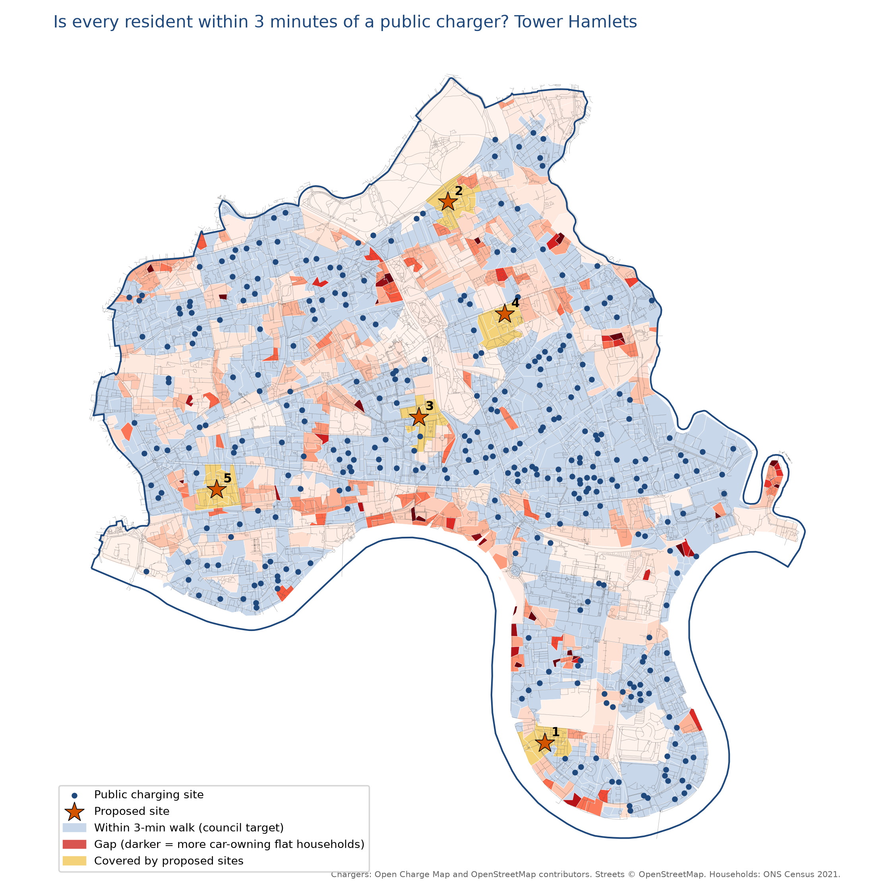

# EV charger access in Tower Hamlets

Tower Hamlets Council wants every resident to be within a 3-minute walk of a public EV charger. Most homes in the borough have no off-street parking, so for anyone with an electric car, public charging is the only option. I wanted to see how close the borough is to that target, focusing on the people who rely on it most: households that own a car but live in a flat.

Short version: about 62% of those households are within 3 minutes of a charger, and 88% are within 5. Roughly 13,000 are still outside the target, but usually only by a few minutes.

[Two-page write-up](report/Tower_Hamlets_EV_Charger_Access.pdf)



## How it works

Household numbers come from the 2021 Census (car ownership and accommodation type, by Output Area). Charger locations come from Open Charge Map and OpenStreetMap. Walking distances follow the actual street network, so canals, docks and railways are treated as the obstacles they are.

OpenStreetMap on its own only had 19 chargers in the borough, which was clearly wrong. Adding Open Charge Map brought it to 315 sites. I then checked the 15 biggest gaps on a live charger map: 13 were real, and 2 had a closer charger the open data had missed. So the headline figure is probably a little low, but not by much.

The census doesn't cross car ownership with housing type for small areas, so I assumed they're independent within each area. The analysis also only looks at distance, not charger speed, price or availability.

## Running it

```bash
pip install -r requirements.txt
export OCM_API_KEY=your_key    # free from openchargemap.org
python ev_charger_access.py
```

You'll need three files in `data/`: the Census tables TS045 and TS044 for Tower Hamlets Output Areas (from Nomis, all categories, with area codes), and the 2021 Output Area boundaries from the ONS Open Geography Portal.

Data: ONS Census 2021 (OGL), Open Charge Map and OpenStreetMap contributors (ODbL).
